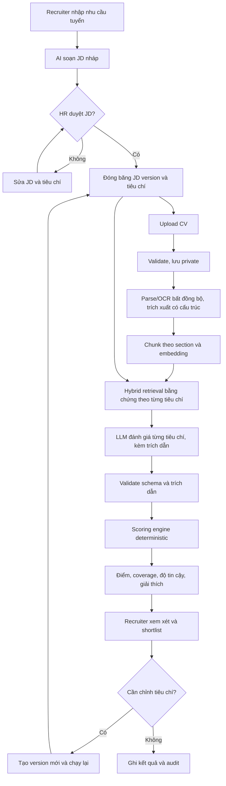
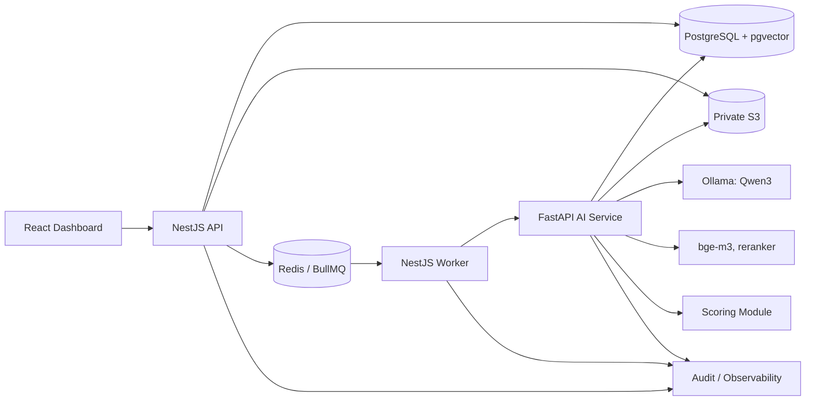
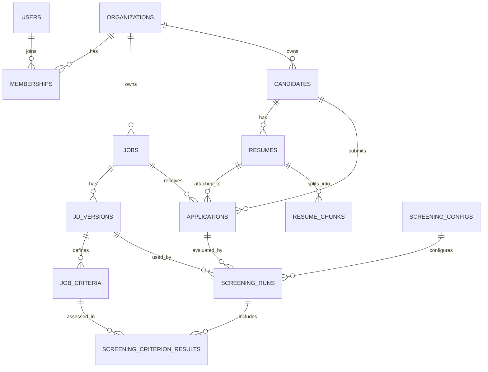

# AI-Assisted Recruitment SaaS — Project Context

Tài liệu nguồn duy nhất về sản phẩm và kỹ thuật của đồ án, dùng cho thiết kế, code, kiểm thử và viết luận văn. Nội dung viết bằng tiếng Việt; thuật ngữ kỹ thuật, tên định danh, API path và tên bảng giữ nguyên tiếng Anh.

| | |
|---|---|
| **Luận văn** | *Design and Development of an AI-Assisted Recruitment Management System Using Large Language Models and Retrieval-Augmented Generation* (Master of Software Engineering, FPT School of Business and Technology) |
| **Trạng thái** | Đang xây dựng. Repo mới có cấu hình hạ tầng và tài liệu, **chưa có code nghiệp vụ** |
| **Quyết định kiến trúc** | Xem [`docs/adr/`](adr/) |
| **Cập nhật** | 2026-11-07 |

> **Không được coi bất kỳ nội dung nào ở đây là đã triển khai, đã đo đạc hay đã kiểm chứng.** Mọi endpoint, bảng, công thức và ngưỡng đều là thiết kế cho đến khi có code và số liệu thực tế.

---

## 0. Cách dùng tài liệu này

### 0.1 Prompt mở đầu cho AI assistant

```text
Đọc docs/README_AI_RECRUITMENT.md làm ngữ cảnh sản phẩm và kỹ thuật của dự án.
Trước khi code, hãy nêu lại: phạm vi tính năng, acceptance criteria, các module
bị ảnh hưởng, ràng buộc tenant/bảo mật, và thay đổi trên API/DB contract.
Giữ nguyên kiến trúc đã chốt và thiết kế human-in-the-loop.
Phân biệt rõ [Chốt], [Đề xuất] và [Mở]. Nếu thiếu đặc tả, hãy hỏi hoặc ghi rõ
giả định. Không tự nghĩ ra file, service, số đo hay tính năng "đã có".
Khi viết code, kèm test cho tenant isolation, validation, idempotency và
authorization nếu liên quan.
```

### 0.2 Mức độ chắc chắn của quyết định

| Nhãn | Ý nghĩa | Cách xử lý |
|---|---|---|
| **[Chốt]** | Hướng đã thống nhất, khớp với luận văn | Muốn đổi phải có architecture decision record (ADR) |
| **[Đề xuất]** | Chi tiết thiết kế hợp lý, chưa được xác nhận | Dùng làm mặc định, được phép điều chỉnh trước khi code |
| **[Mở]** | Chưa quyết định (xem [mục 17](#17-các-quyết-định-còn-mở)) | Không tự chọn thay; hỏi hoặc ghi rõ giả định |

Những gì **[Chốt]**: React + TypeScript, NestJS, FastAPI, PostgreSQL + pgvector, S3-compatible private storage, Redis + BullMQ, multi-tenant SaaS, JD do người duyệt, parsing + embedding + RAG, scoring engine deterministic tách riêng, kết quả giải thích được bằng bằng chứng, audit trail, recruiter giữ quyền quyết định. Ngoài ra là các quyết định trong [`docs/adr/`](adr/): chạy local, Qwen3 tự host có fallback, `bge-m3` + `bge-reranker-v2-m3`, chỉ dùng pgvector, auth tự làm, `match_value` theo rubric, phạm vi hệ thống.

Mọi nội dung còn lại (JSON mẫu, cột và index, công thức coverage, cấu trúc thư mục, KPI, lộ trình) là **[Đề xuất]**, trừ khi được ghi khác.

Hướng cũ Next.js / FastAPI-only / Chroma / Ollama từng được cân nhắc nhưng **không** còn là baseline.

---

## 1. Tổng quan sản phẩm

### 1.1 Vấn đề

Tuyển dụng thủ công phải đọc nhiều CV khác định dạng, làm việc với JD mơ hồ, nhập liệu trùng lặp, và mỗi người sàng lọc một kiểu. So khớp từ khoá bỏ sót các cách diễn đạt tương đương, trong khi CV lặp nhiều từ khoá lại trông như giỏi. LLM dùng tự do thì trả lời trôi chảy nhưng không có bằng chứng truy vết được.

Recruiter cần bằng chứng nhất quán, tiêu chí minh bạch và một quy trình mình kiểm soát được, chứ không cần một phán quyết hộp đen.

### 1.2 Mục tiêu

Xây dựng SaaS quản lý tuyển dụng đa tổ chức, có AI hỗ trợ:

1. Soạn và chỉnh JD (JD Generator).
2. Upload, parse, cấu trúc hoá và tìm kiếm CV.
3. Đối chiếu bằng chứng trong CV với tiêu chí **đã duyệt** bằng retrieval + LLM.
4. Tính điểm tái lập được, cấu hình được, bằng engine **deterministic**.
5. Giải thích kết quả bằng trích dẫn từ CV, nói rõ phần nào không có thông tin.
6. Lưu quyết định, nhận xét và lịch sử audit của HR.

> **Định vị:** đây là công cụ **hỗ trợ quyết định**, không tự động loại hay tuyển ứng viên. Điểm số chỉ thể hiện mức bằng chứng khớp với bộ tiêu chí của một JD cụ thể, **không** phải thước đo năng lực hay mức phù hợp chung của một con người.

### 1.3 Người dùng

| Persona | Vai trò |
|---|---|
| Organization Owner/Admin | Quản lý workspace, thành viên, quyền, chính sách, cấu hình |
| Recruiter/HR | Tạo job, sửa và duyệt JD, upload CV, chạy sàng lọc, xem bằng chứng, shortlist |
| Hiring Manager | Duyệt JD, xem job được phân công, nhận xét ứng viên, chốt shortlist |
| Candidate | Người có CV được xử lý; không có cổng ứng viên trong đợt này |
| Platform Operator | Vận hành hạ tầng; mặc định **không** truy cập nội dung CV của tenant |

### 1.4 Luồng chính



Khi cần chỉnh, hệ thống **tạo version mới**, không sửa JD hay tiêu chí của một lần sàng lọc đã hoàn tất.

---

## 2. Phạm vi và nguyên tắc

### 2.1 Trong phạm vi MVP

| Mảng | Năng lực | Hành vi bắt buộc |
|---|---|---|
| Workspace | Membership, chuyển tenant | Mọi thao tác được bảo vệ đều gắn `organization_id` đang active |
| Jobs | CRUD, tiêu chí, JD versioning | Phải duyệt trước khi sàng lọc |
| JD AI | Soạn, viết lại, chỉ ra chỗ thiếu | Chỉ là bản nháp; người duyệt rõ ràng |
| Candidates | Hồ sơ, application, upload CV | Giữ version và nguồn gốc file |
| AI parsing | Trích text PDF/DOCX, OCR fallback | Không bịa thông tin CV không có |
| Matching | Hybrid retrieval + đánh giá theo tiêu chí | Trích dẫn bằng chứng, thể hiện sự không chắc chắn |
| Scoring | Weighted scoring deterministic | Trọng số/ngưỡng có version; phân biệt `unknown` với không đạt |
| Recruiter UX | Bảng xếp hạng, lý do, review thủ công | Không tự động loại hay tuyển |
| Hiring Manager | Duyệt JD, nhận xét, chốt shortlist | Chỉ thao tác trên job được phân công |
| Giao diện | Tiếng Việt và tiếng Anh | Mọi chuỗi UI đi qua i18n |
| Vận hành | Job, retry, log, audit | Xử lý idempotent, observability theo tenant |

### 2.2 Ngoài phạm vi MVP

- Tự liên hệ hoặc từ chối ứng viên khi recruiter chưa duyệt.
- Dự đoán thuộc tính cá nhân nhạy cảm.
- Tự train foundation LLM.
- Payroll, chấm công, ERP, HRM tổng thể.
- Phỏng vấn video tự động, suy luận cảm xúc hoặc tính cách.
- Billing và tự động hoá compliance.
- Cổng ứng viên, kanban, lịch phỏng vấn, email.
- MFA, SSO và triển khai cloud.
- Quét malware. Đây là **giới hạn đã biết**, phải xử lý trước khi nhận file thật từ bên ngoài.

### 2.3 Bảy nguyên tắc lõi

1. **Tiêu chí được duyệt trước.** Không chấm điểm trên JD nháp.
2. **Bằng chứng trước.** Mọi kết luận khớp phải trỏ được về một đoạn trong CV.
3. **Điểm deterministic.** LLM trả đánh giá có cấu trúc theo tiêu chí; điểm tổng do code tính.
4. **Tenant isolation từ thiết kế.** Áp dụng ở API, query, file, queue và vector retrieval.
5. **Version mọi thứ quan trọng.** JD, tiêu chí, CV, parser, prompt, model, scoring config.
6. **Con người giám sát.** Kết quả xem lại được, phản biện được, override được và có ghi lý do.
7. **Riêng tư mặc định.** PII ở mức tối thiểu, lưu trữ private và mã hoá, hỗ trợ retention/xoá.

---

## 3. Kiến trúc tổng thể

### 3.1 Công nghệ baseline [Chốt]

| Tầng | Lựa chọn | Trách nhiệm |
|---|---|---|
| Web | React + TypeScript + Vite | Dashboard recruiter, màn hình review, admin |
| Core backend | NestJS | AuthN/AuthZ, tenant, job, application, điều phối sàng lọc, audit, public API |
| AI service | Python FastAPI | Parsing, OCR, trích xuất, embedding, retrieval, đánh giá tiêu chí, scoring module |
| Quan hệ + vector | PostgreSQL + pgvector | Dữ liệu giao dịch và vector theo tenant |
| Object storage | S3-compatible private bucket | CV gốc và artifact xử lý |
| Bất đồng bộ | Redis + BullMQ | Điều phối từ NestJS, retry, trạng thái |
| Giám sát | Structured log, metric, trace | Lỗi, chi phí, độ trễ, khả năng audit |
| LLM | Qwen3 bản nhỏ qua Ollama (ADR 0002) | Soạn JD, trích xuất, đánh giá tiêu chí, gọi qua interface `LLMProvider` |
| Embedding, rerank | `bge-m3`, `bge-reranker-v2-m3` (ADR 0003) | Retrieval trong phạm vi một CV |

PostgreSQL, Redis và object storage RustFS (ADR 0007) chạy trong Docker; Ollama và AI service chạy native trên macOS vì Docker trên Mac không dùng được GPU (ADR 0001).

### 3.2 Sơ đồ logic



### 3.3 Ranh giới trách nhiệm

- **NestJS** sở hữu identity, tenant context, quyền, trạng thái workflow, public API và metadata bất biến của mỗi lần chạy.
- **FastAPI** làm phần xử lý tài liệu/NLP tốn kém. Client không được gọi thẳng; internal endpoint yêu cầu service authentication.
- **Schema database do một nơi sở hữu** **[Đề xuất]**: migration nằm ở `infra/migrations`. FastAPI chỉ ghi vào nhóm bảng xử lý AI (`resume_chunks`, `document_processing_runs`, kết quả đánh giá) qua DB role riêng với quyền hẹp; không đụng `users`, `memberships`, `jobs`.

### 3.4 BullMQ và Python

BullMQ là công nghệ gốc Node.js. Dù có Python client, độ đầy đủ tính năng không ngang bản Node, nên **không** coi FastAPI là BullMQ worker mặc định.

**[Đề xuất]** cho MVP: BullMQ worker trong NestJS gọi internal endpoint của FastAPI đã xác thực. Lưu ý khi triển khai:

- Mỗi giai đoạn (parse, index, assess) là một job riêng, để retry không phải làm lại từ đầu và worker không giữ một HTTP call quá lâu.
- Đặt timeout rõ ràng cho từng lời gọi; lock duration của BullMQ phải dài hơn timeout đó.
- Chỉ enqueue sau khi transaction DB đã commit (outbox pattern nếu cần đảm bảo không mất job).

Phương án thay thế là một Python queue/worker riêng, cần được quyết định tường minh ([mục 17](#17-các-quyết-định-còn-mở)).

### 3.5 Vòng đời bất đồng bộ

Một CV được xử lý một lần nhưng có thể được sàng lọc cho nhiều job, nên có **hai state machine tách biệt**:

**Document** (trên `resumes.parse_status`):

```text
uploaded → queued → validating → extracting → indexing → ready
```

Kết thúc lỗi: `rejected` (không qua validate), `failed_extraction`, `failed_provider`, `cancelled`.

**Screening run** (trên `screening_runs.status`):

```text
queued → waiting_document → retrieving → assessing → validating → scoring → completed
```

Kết thúc lỗi: `failed_validation`, `failed_provider`, `cancelled`.

`needs_manual_review` **không** phải lỗi. Đó là cờ `requires_manual_review` trên run đã `completed` hoặc trên document (ví dụ OCR kém). Ghi lại số lần retry và backoff; tài liệu luôn lỗi (poison document) chuyển sang dead-letter queue để xem xét.

---

## 4. Multi-tenant và phân quyền

### 4.1 Mô hình cách ly

Mặc định MVP: **một PostgreSQL dùng chung, mọi bản ghi của tenant có `organization_id`**, kết hợp authorization và query scoping chặt chẽ.

| Lớp | Quy tắc |
|---|---|
| Đăng nhập | Xác định `user_id`; **active organization** được chọn và kiểm tra với membership phía server |
| Quyền | Suy ra từ membership của tenant đó, không tin role do client gửi lên |
| Dữ liệu | Candidate, CV, application, JD, chunk, screening đều gắn tổ chức đang active |
| File | Object key gồm tenant + ID không đoán được; URL tải có hạn, cấp **sau khi** authorize |
| Vector | Retrieval luôn lọc `organization_id` và `resume_id`; không bao giờ tìm xuyên tenant |
| Queue | Payload có `organization_id`, actor, idempotency key, resource ID; worker **kiểm tra lại** trước khi chạy |
| Quan hệ | Chặn FK chéo tenant bằng composite key ([mục 5.3](#53-ràng-buộc-và-index)) |
| Vòng đời | Xoá/export tenant áp dụng cho file gốc, text, chunk, vector, cache và backup theo chính sách retention |

### 4.2 Row-Level Security [Đề xuất]

RLS là lớp phòng thủ thứ hai, phòng trường hợp code quên điều kiện tenant:

```sql
-- Minh hoạ: giả định ID kiểu uuid.
ALTER TABLE resumes ENABLE ROW LEVEL SECURITY;
ALTER TABLE resumes FORCE ROW LEVEL SECURITY;

CREATE POLICY tenant_isolation ON resumes
  USING (organization_id = current_setting('app.organization_id')::uuid);
```

- Đặt context bằng `SET LOCAL app.organization_id = ...` **trong transaction**, để không rò sang request khác khi dùng connection pool.
- Thiếu context thì `current_setting` báo lỗi, tức là fail closed. Đó là hành vi mong muốn.
- Ứng dụng phải kết nối bằng role không phải superuser và không có `BYPASSRLS`.
- Background job cũng phải set context, không có đường tắt.

### 4.3 Vai trò [Đề xuất]

| Role | Workspace | JD | CV / sàng lọc | Quyết định cuối |
|---|---|---|---|---|
| Owner | Quản lý | Quản lý, duyệt | Quản lý, review | Có |
| Admin | Quản lý trong phần được cấp | Quản lý, duyệt | Quản lý, review | Theo chính sách |
| Recruiter | Hạn chế | Tạo, sửa, xin duyệt | Upload, sàng lọc, review | Theo chính sách |
| Hiring Manager | Hạn chế | Nhận xét, duyệt | Xem job được phân quyền | Có, nếu được cấp |
| Viewer | Xem phần được cấp | Xem | Xem bản đã che thông tin | Không |

Kiểm tra quyền theo action (`jd:approve`, `screening:run`, `resume:download`), không hardcode role trong từng controller.

---

## 5. Database [Đề xuất]

### 5.1 Bảng lõi

| Bảng | Cột chính (minh hoạ) | Ghi chú |
|---|---|---|
| `organizations` | `id`, `name`, `slug`, `settings_json`, `created_at` | Workspace |
| `users` | `id`, `email`, `display_name`, `auth_subject`, `created_at` | Identity toàn cục; không chứa PII từ CV |
| `memberships` | `id`, `organization_id`, `user_id`, `role`, `status` | Unique `(organization_id, user_id)` |
| `jobs` | `id`, `organization_id`, `title`, `status`, `created_by`, `active_jd_version_id` | Vị trí tuyển dụng |
| `jd_versions` | `id`, `organization_id`, `job_id`, `version_no`, `content_json`, `approval_status`, `approved_by`, `approved_at`, `prompt_version` | Bất biến sau khi duyệt |
| `job_assignments` | `id`, `organization_id`, `job_id`, `user_id`, `role` | Hiring Manager được phân công cho job |
| `job_criteria` | `id`, `organization_id`, `jd_version_id`, `code`, `label`, `type`, `description`, `priority`, `weight`, `evidence_guidance_json`, `sort_order` | Thuộc về một JD version |
| `candidates` | `id`, `organization_id`, `display_name`, `contact_json`, `consent_status` | Không giả định email là unique toàn cục |
| `resumes` | `id`, `organization_id`, `candidate_id`, `version_no`, `object_key`, `mime_type`, `sha256`, `parse_status`, `created_at` | File private |
| `applications` | `id`, `organization_id`, `job_id`, `candidate_id`, `resume_id`, `stage`, `created_at` | Candidate ↔ job |
| `resume_chunks` | `id`, `organization_id`, `resume_id`, `section`, `page`, `text`, `text_search`, `embedding`, `embedding_version`, `start_offset`, `end_offset` | Tìm kiếm trong phạm vi tenant |
| `screening_runs` | `id`, `organization_id`, `application_id`, `jd_version_id`, `resume_id`, `scoring_config_id`, `pipeline_fingerprint`, `pipeline_versions_json`, `status`, `score_state`, `observed_score`, `coverage`, `lower_bound`, `upper_bound`, `requires_manual_review`, `created_at` | Đầu vào bất biến |
| `screening_criterion_results` | `id`, `organization_id`, `screening_run_id`, `criterion_id`, `status`, `match_value`, `weight`, `confidence`, `evidence_json`, `reason`, `raw_assessment_json` | Giữ cả output thô và bản đã validate |
| `audit_events` | `id`, `organization_id`, `actor_id`, `action`, `resource_type`, `resource_id`, `metadata_json`, `created_at` | Append-only |

`pipeline_versions_json` lưu parser, embedding, retrieval, prompt và model của lần chạy; `pipeline_fingerprint` là hash của nó.

### 5.2 Bảng phụ

| Bảng | Nội dung |
|---|---|
| `document_processing_runs` | Version parser/OCR, lỗi, checksum, cờ chất lượng, `extracted_text_key` (text chuẩn hoá trên S3, là mốc của offset), `structured_profile_json` |
| `jd_generation_runs` | Tham số, prompt/model version, bản nháp, cảnh báo, token, trạng thái review |
| `screening_configs` | Version quy tắc, `rubric_values` (ánh xạ level sang số), chính sách `unknown`, `min_coverage`, ngưỡng |
| `human_reviews` | Người review, override theo tiêu chí, nhận xét, quyết định shortlist, lý do, thời điểm |
| `organization_settings` | Retention, model endpoint được phép, quota, ngôn ngữ |
| `api_idempotency_keys`, `background_jobs` | Theo dõi request và lần thực thi trùng |

### 5.3 Ràng buộc và index

```sql
-- Minh hoạ: cần rà soát trước khi đưa vào migration.
CREATE UNIQUE INDEX ux_membership_org_user
  ON memberships (organization_id, user_id);
CREATE INDEX ix_application_org_job
  ON applications (organization_id, job_id);
CREATE INDEX ix_resume_chunks_tenant_resume
  ON resume_chunks (organization_id, resume_id);
CREATE INDEX ix_screening_runs_tenant_application
  ON screening_runs (organization_id, application_id, created_at DESC);

-- Replay không tạo run trùng; đổi JD, config hoặc pipeline thì tạo run mới.
CREATE UNIQUE INDEX ux_screening_runs_identity
  ON screening_runs (organization_id, application_id, resume_id,
                     jd_version_id, scoring_config_id, pipeline_fingerprint);

-- Composite FK để database chặn liên kết chéo tenant.
ALTER TABLE jobs ADD CONSTRAINT ux_jobs_org_id UNIQUE (organization_id, id);
ALTER TABLE applications ADD CONSTRAINT fk_application_job
  FOREIGN KEY (organization_id, job_id) REFERENCES jobs (organization_id, id);
```

Áp dụng composite FK tương tự cho `job → jd_version → criteria`, `application → resume` và `screening_run → mọi đầu vào`. `screening_runs` chỉ tham chiếu dữ liệu bất biến nên điểm cũ luôn tái lập được.

Về vector index, xem [mục 9.3](#93-lưu-ý-về-embedding-và-index).

### 5.4 ERD (rút gọn)



---

## 6. API [Đề xuất]

Mọi route dưới đây là public API dự kiến, nằm dưới `/api/v1`, yêu cầu xác thực và gắn tenant. Tenant lấy từ active organization đã được server kiểm tra membership; route `/organizations/:orgId/*` cũng phải kiểm tra `orgId` với membership. Cơ chế cụ thể là một quyết định còn mở.

| Method | Endpoint | Mục đích |
|---|---|---|
| `POST` | `/auth/login` | Đăng nhập, nếu tự làm auth |
| `GET` | `/me` | Identity và memberships |
| `GET` / `POST` | `/organizations` | Liệt kê tenant / tạo tổ chức |
| `GET` | `/organizations/:orgId/members` | Danh sách thành viên |
| `POST` | `/organizations/:orgId/invitations` | Mời kèm role |
| `GET` / `POST` | `/jobs` | Tìm kiếm / tạo job |
| `GET` / `PATCH` | `/jobs/:jobId` | Chi tiết / sửa metadata |
| `POST` | `/jobs/:jobId/jd/generate` | AI soạn nháp |
| `GET` / `POST` | `/jobs/:jobId/jd/versions` | Lịch sử JD / lưu bản nháp |
| `GET` | `/jobs/:jobId/jd/versions/:versionId` | Chi tiết version, gồm tiêu chí |
| `PUT` | `/jobs/:jobId/jd/versions/:versionId/criteria` | Sửa tiêu chí và trọng số khi còn nháp |
| `POST` | `/jobs/:jobId/jd/versions/:versionId/approve` | Duyệt và đóng băng |
| `GET` / `POST` | `/candidates` | Danh sách / tạo ứng viên |
| `DELETE` | `/candidates/:candidateId` | Xoá theo chính sách retention |
| `POST` | `/resumes/upload` | Upload hoặc presign |
| `POST` | `/resumes/bulk-upload` | Nhận nhiều file |
| `GET` | `/resumes/:resumeId/status` | Trạng thái xử lý |
| `GET` | `/resumes/:resumeId/download-url` | Signed URL ngắn hạn, đã authorize |
| `GET` / `POST` | `/jobs/:jobId/applications` | Danh sách có phân trang / gắn ứng viên và CV |
| `POST` | `/jobs/:jobId/screenings` | Enqueue sàng lọc trên JD đã duyệt |
| `GET` | `/screenings/:screeningId` | Breakdown, bằng chứng, metadata |
| `POST` | `/screenings/:screeningId/reviews` | HR review/override |
| `GET` | `/jobs/:jobId/rankings?jd_version_id=&scoring_config_id=` | Xếp hạng trong **một** JD version và config |
| `GET` | `/audit-events` | Xem audit theo quyền |

### 6.1 Ví dụ tạo sàng lọc

`Idempotency-Key` do client sinh cho **mỗi thao tác**, nên một request có thể chứa nhiều application. Việc chống run trùng ở cấp dữ liệu do unique index tại [mục 5.3](#53-ràng-buộc-và-index) đảm nhiệm.

```http
POST /api/v1/jobs/job_100/screenings
Idempotency-Key: 6f1c2f0e-9d43-4a57-8f7e-3b1f4a2c9e10
Content-Type: application/json

{
  "application_ids": ["application_200"],
  "jd_version_id": "jdv_5",
  "scoring_config_id": "scfg_2"
}
```

```json
{
  "runs": [
    {
      "application_id": "application_200",
      "screening_run_id": "run_300",
      "status": "queued"
    }
  ]
}
```

Trả `202 Accepted` cho việc đã enqueue; dùng polling trước, SSE/WebSocket để sau. Chuẩn hoá phân trang, lỗi, correlation ID và giới hạn kích thước request. Không chạy LLM trên request đồng bộ, trừ JD Generator nếu quyết định dùng streaming.

### 6.2 Internal AI contract (không lộ ra browser)

- `POST /internal/v1/documents/parse`
- `POST /internal/v1/documents/index`
- `POST /internal/v1/screenings/evaluate`
- `POST /internal/v1/jd/generate`

Bảo vệ bằng service identity, payload được ký và giới hạn phạm vi, private network và timeout. Không chấp nhận lời gọi server-to-server chưa xác thực hay tenant ID suy đoán.

---

## 7. JD Generator

### 7.1 Luồng làm việc

1. Recruiter nhập tên vị trí, cấp bậc, địa điểm/hình thức làm việc, trách nhiệm, công nghệ/kỹ năng, kinh nghiệm mong muốn và bối cảnh tổ chức.
2. AI tạo JD **nháp** có cấu trúc: trách nhiệm, yêu cầu bắt buộc, yêu cầu ưu tiên và gợi ý tiêu chí sàng lọc.
3. Hệ thống chỉ ra chỗ mơ hồ, trùng lặp, mâu thuẫn hoặc còn thiếu; tách rõ bắt buộc và nice-to-have.
4. Recruiter sửa, duyệt, tạo `jd_version` bất biến cùng bộ tiêu chí chuẩn hoá.
5. Lần sàng lọc tham chiếu đúng version đã duyệt đó.

### 7.2 AI contract

```json
{
  "title": "React Native Developer",
  "summary": "...",
  "responsibilities": ["..."],
  "required_qualifications": ["..."],
  "preferred_qualifications": ["..."],
  "screening_criteria_suggestions": [
    {"label": "React Native delivery experience", "must_have": true, "proposed_weight": 20}
  ],
  "assumptions_to_confirm": ["Team size not provided"],
  "warnings": ["Seniority level is ambiguous"]
}
```

### 7.3 Quy tắc an toàn

- Đầu vào: form có cấu trúc + template JD đã duyệt của chính tổ chức; giữ ranh giới tenant.
- Output theo schema, giới hạn độ dài trường, có prompt/model version, validate đầu vào.
- Không tự nghĩ ra lương, chính sách công ty, bằng cấp, điều kiện pháp lý hay phúc lợi.
- Cảnh báo ngôn từ có nguy cơ phân biệt đối xử; quyết định compliance cuối cùng thuộc về con người.
- Phân biệt tiêu chí, trọng số **được gợi ý** và **đã duyệt**.
- AI được đề xuất chỉnh sửa, nhưng **không được tự xuất bản** hay sửa JD đã duyệt.

---

## 8. Pipeline xử lý CV

1. **Authorize:** xác nhận actor, tổ chức, quyền trên job/application.
2. **Validate file:** PDF/DOCX được hỗ trợ, MIME khớp extension, giới hạn dung lượng và số trang, chống file nén độc hại (DOCX là file zip).
3. **Lưu private:** file gốc bất biến trong storage theo tenant, kèm hash, metadata, nguồn, version.
4. **Enqueue:** job idempotent, không chặn frontend.
5. **Trích text:** parse PDF/DOCX, OCR fallback cho bản scan; giữ thông tin trang, section, ranh giới. Chạy parser cách ly vì file là dữ liệu không tin cậy.
6. **Đánh giá chất lượng:** gắn cờ trang trống, nội dung không đọc được, layout vỡ, ngôn ngữ không rõ, OCR kém, và **chữ ẩn** (chữ trắng trên nền trắng, cỡ chữ 0) vốn hay dùng để nhồi từ khoá hoặc prompt injection.
7. **Trích xuất có cấu trúc bằng LLM:** kỹ năng, dự án, học vấn, kinh nghiệm, validate chặt; kèm liên kết bằng chứng và độ không chắc chắn.
8. **Chuẩn hoá:** thống nhất ngày tháng và từ đồng nghĩa kỹ năng mà không bịa chi tiết thiếu; giữ text gốc.
9. **Chunk:** theo section (kinh nghiệm, dự án, học vấn, kỹ năng); giữ trang và character offset.
10. **Embed:** ghi đúng model, version, dimension, phạm vi tenant/CV.
11. **Index:** lưu vector và dữ liệu lexical search; xác định cách xử lý xoá và version.
12. **Retrieve theo tiêu chí:** lexical + vector, có thể rerank, lọc nghiêm cùng tenant và cùng CV.
13. **LLM đánh giá bằng chứng:** contract có cấu trúc, trích dẫn, độ tin cậy, thông tin thiếu.
14. **Validate:** kiểm tra trích dẫn, enum, khoảng giá trị, lỗi model, chặn PII vào log.
15. **Score:** engine deterministic với chính sách `unknown` tường minh.
16. **Persist:** snapshot lần chạy, đánh giá theo tiêu chí, coverage, điểm, version, chi phí, độ trễ.
17. **Human review:** recruiter xem đoạn trích, có thể override và ghi lý do kèm thời điểm.

Bước 1–11 thuộc document state machine, chạy một lần cho mỗi CV. Bước 12–17 thuộc screening run, chạy cho mỗi cặp CV + JD version.

**Xử lý lại và idempotency**

- Upload lại cùng CV **trong cùng tenant** không cần parse/index lại nếu `sha256` và parser config trùng; nhiều application có thể trỏ tới cùng nội dung. Không dùng chung kết quả giữa các tenant.
- Khác JD version, scoring config hoặc pipeline thì tạo run mới.
- Replay không tạo run trùng; chuyển trạng thái phải an toàn khi retry.
- Xoá CV phải vô hiệu hoá chunk và signed URL liên quan theo chính sách.

---

## 9. RAG cho bài toán tuyển dụng

### 9.1 Đơn vị truy xuất đúng

Câu hỏi cần trả lời là: **"Bằng chứng nào trong CV của chính ứng viên này hỗ trợ tiêu chí đã duyệt này?"**

Vì vậy kho truy xuất không phải tập CV của mọi ứng viên, mà là các chunk của **một** CV trong **một** tenant. Template JD của tổ chức thuộc một knowledge collection riêng có phân quyền. Kiến thức bên ngoài chỉ được dùng để làm rõ thuật ngữ, không bao giờ thay cho bằng chứng từ CV.

### 9.2 Luồng retrieval

```text
Đầu vào: tiêu chí đã duyệt + jd_version_id + resume_id + organization_id
  -> lexical query (từ khoá, alias, từ đồng nghĩa kỹ năng)
  -> semantic query (embedding)
  -> gộp và loại trùng (hybrid, ví dụ reciprocal rank fusion)
  -> rerank trong cùng CV
  -> trả top-k đoạn kèm chunk_id, page, offset
  -> LLM đánh giá CHỈ dựa trên các đoạn đó
  -> validate JSON schema và trích dẫn
  -> kết quả theo tiêu chí
```

Hybrid là giả thuyết cần kiểm chứng, không phải kết luận: phải so với dense-only và lexical-only trên cùng tập dữ liệu ([mục 13](#13-đánh-giá-trước-khi-ra-mắt)). Gửi ít đoạn đã chọn lọc thay vì toàn bộ CV cũng là giả thuyết, dựa trên việc model dùng kém thông tin nằm giữa ngữ cảnh dài, và chỉ đúng khi Recall@k đủ cao.

### 9.3 Lưu ý về embedding và index

- **Thường không cần ANN index cho sàng lọc.** Mỗi truy vấn chỉ quét chunk của một CV (vài chục dòng), nên lọc theo B-tree `(organization_id, resume_id)` rồi so khoảng cách chính xác là đủ nhanh và recall tuyệt đối. Ngược lại, HNSW/IVFFlat lọc *sau* khi quét nên với filter hẹp có thể trả về ít hơn k kết quả. Chỉ cân nhắc ANN khi có tính năng tìm ứng viên trên toàn tenant, và benchmark với filter thật.
- **Tiếng Việt trong lexical search.** PostgreSQL không có text search config tiếng Việt sẵn; dùng `simple`, có thể thêm `unaccent` hoặc `pg_trgm`, và mở rộng query bằng alias kỹ năng. Cần test với CV trộn Việt–Anh.
- Dimension, tokenization, hỗ trợ đa ngôn ngữ và ngưỡng phụ thuộc model đã chọn.
- Đổi model thường phải embed lại toàn bộ, nên cột `embedding_version` và chiến lược migration là bắt buộc. Trong một truy vấn chỉ so vector cùng version.
- Không coi cosine similarity là điểm kỹ năng 0–100 đã hiệu chuẩn. Nó chỉ là tín hiệu retrieval.

### 9.4 Yêu cầu chống hallucination

- Prompt yêu cầu bám bằng chứng và trả `unknown` khi không có thông tin.
- Mọi kết luận `supported` phải có trích dẫn chính xác.
- Đối chiếu trích dẫn với dữ liệu lưu trữ; không có bằng chứng hợp lệ thì không được kết luận `supported`.
- Tách `confidence` khỏi `match_value`.
- Đánh giá riêng retrieval (có lấy đúng đoạn không) và grounding (kết luận có suy ra được từ đoạn đó không).
- **CV là đầu vào không tin cậy.** Tách rõ phần chỉ dẫn và phần dữ liệu trong prompt; không thực thi chỉ thị nằm trong CV; model không có tool hay quyền gì để hành động theo chỉ thị đó.

---

## 10. Đánh giá theo tiêu chí

### 10.1 Đầu vào

- `jd_version_id` đã duyệt cùng `job_criteria` có trọng số.
- `resume_id`, document version, các chunk với source reference ổn định.
- Model config và `scoring_config_id` của tenant.

### 10.2 Mô hình tiêu chí (ví dụ)

```json
{
  "criterion_id": "crit_123",
  "code": "react_native_performance",
  "label": "React Native performance optimization",
  "type": "technical_skill",
  "priority": "must_have",
  "weight": 25,
  "description": "Evidence of profiling and improving mobile UI performance",
  "evidence_guidance": [
    "reduced avoidable re-renders",
    "optimized large lists",
    "measured startup latency"
  ]
}
```

Trọng số trong ví dụ chỉ để minh hoạ. Tiêu chí và mức quan trọng thực tế phải do người có thẩm quyền duyệt; tránh tiêu chí proxy không liên quan đến công việc.

### 10.3 Assessment contract

```json
{
  "criterion_id": "crit_123",
  "level": "adequate",
  "confidence": 0.85,
  "reason": "Candidate describes improving list responsiveness in a React Native project.",
  "evidence": [
    {
      "resume_chunk_id": "chunk_456",
      "page": 2,
      "quote": "Reduced unnecessary list item renders by memoizing row components",
      "start_offset": 130,
      "end_offset": 195
    }
  ],
  "missing_information": []
}
```

`start_offset` và `end_offset` là vị trí nửa mở `[start, end)` trên text chuẩn hoá của phiên bản CV. `quote` phải khớp chính xác đoạn đó, nên không được rút gọn bằng dấu `...`.

LLM chỉ chọn `level`. Code suy ra `status`, còn `match_value` lấy từ `rubric_values` trong `screening_configs` (ADR 0005). Số dưới đây là mặc định minh hoạ, chưa hiệu chuẩn.

| `level` | Ý nghĩa | `status` suy ra | `match_value` | Tính vào điểm |
|---|---|---|---:|---|
| `strong` | Bằng chứng rõ, có kết quả hoặc phạm vi cụ thể | `supported` | 1.0 | Có |
| `adequate` | Có bằng chứng rõ ràng, ở mức đạt yêu cầu | `supported` | 0.7 | Có |
| `partial` | Bằng chứng một phần | `partially_supported` | 0.4 | Có |
| `absent` | Bằng chứng **cho thấy** không đạt | `not_supported` | 0 | Có |
| `unknown` | CV không đề cập | `unknown` | `null` | Không |
| `needs_review` | Mâu thuẫn, OCR kém, độ tin cậy thấp | `needs_review` | `null` | Không |

Điểm then chốt: **không đề cập ≠ không đạt**. CV không nhắc đến thì thường là `unknown`; `not_supported` chỉ dùng khi có bằng chứng biện minh cho kết luận đó. Luận văn gọi trạng thái này là *unsupported*; trong code thống nhất dùng `not_supported`.

### 10.4 Quy tắc đánh giá

- Retrieve **theo từng tiêu chí**, không dồn tất cả vào một prompt lớn.
- LLM chỉ được dùng bằng chứng đã truy xuất. Cấm suy diễn bằng cấp, ngày tháng, số năm kinh nghiệm, chứng chỉ, nhà tuyển dụng hay kỹ năng.
- Validate schema và xác minh `quote`/offset trỏ tới text có thật.
- Lấy nhiều đoạn khi cần; khi có mâu thuẫn hoặc độ tin cậy thấp thì chuyển `needs_review`.
- OCR thiếu hoặc kém là sự không chắc chắn của quá trình trích xuất, không phải lỗi của ứng viên.
- **Tối thiểu dữ liệu [Đề xuất]:** bỏ tên, ảnh, địa chỉ, ngày sinh và thông tin liên hệ khỏi ngữ cảnh gửi LLM khi đánh giá. Việc này vừa giảm PII gửi ra provider, vừa giảm cơ hội model bị ảnh hưởng bởi thuộc tính nhân khẩu học.
- Lưu riêng output thô, bản đã validate, đầu vào scoring và override của con người.
- `level` khác `unknown`, `needs_review` phải có bằng chứng hợp lệ. Trích dẫn không qua được kiểm tra thì hạ xuống `needs_review`.

### 10.5 Hiển thị cho recruiter

- Điểm tổng (khi có ý nghĩa), version config, **coverage**, tín hiệu về độ tin cậy.
- Theo từng tiêu chí: mô tả, trọng số, đánh giá, bằng chứng kèm số trang, chi tiết còn thiếu, giới hạn xử lý.
- Cờ thủ công: độ tin cậy thấp, bằng chứng mâu thuẫn, PDF parse thiếu, chữ ẩn, ứng viên yêu cầu sửa thông tin.
- Hành động: chấp nhận, sửa dữ liệu cấu trúc, override kèm lý do, yêu cầu làm rõ, chạy lại với version mới.

---

## 11. Scoring Engine

### 11.1 Công thức cơ bản [Chốt]

Với tiêu chí `i = 1..n`, trọng số đã duyệt `w_i ≥ 0`, giá trị khớp `m_i ∈ [0,1]`, và `Σ w_i > 0`:

```text
S = 100 × Σ(w_i × m_i) / Σ(w_i)
```

Đây là công thức danh nghĩa, chỉ áp dụng khi mọi tiêu chí đều có giá trị hợp lệ. Tiêu chí `unknown` hoặc `needs_review` **không** được ngầm gán 0 hay 1.

### 11.2 Chính sách theo coverage [Đề xuất]

Gọi `K` là tập tiêu chí đã validate có status thuộc `supported`, `partially_supported`, `not_supported`.

```text
known_weight   = Σ(i ∈ K) w_i
all_weight     = Σ(mọi i) w_i
coverage       = known_weight / all_weight
observed_score = 100 × Σ(i ∈ K)(w_i × m_i) / known_weight

lower_bound    = 100 × Σ(i ∈ K)(w_i × m_i) / all_weight
upper_bound    = 100 × [Σ(i ∈ K)(w_i × m_i) + Σ(i ∉ K) w_i] / all_weight
```

- `lower_bound` và `upper_bound` là điểm khi mọi tiêu chí chưa biết lần lượt đạt 0 và đạt 1. Khoảng này thể hiện **sự thiếu thông tin**, không phải khoảng tin cậy thống kê hay xác suất được tuyển.
- Nếu `coverage < min_coverage` (ngưỡng trong `screening_configs`), **không** công bố `observed_score`: đặt `score_state = insufficient_coverage` và đưa hồ sơ vào nhóm cần bổ sung thông tin, không xếp hạng cùng nhóm có điểm. Điều này khớp với luận văn (mục 2.2.3). Trường hợp `known_weight = 0` là dạng đặc biệt của quy tắc này.
- `confidence` **không** nhân vào điểm. Độ tin cậy thấp chuyển tiêu chí sang `needs_review`, để chỉ có một cơ chế xử lý sự không chắc chắn.

### 11.3 Ví dụ (minh hoạ, không phải benchmark)

| Tiêu chí | Trọng số | Đánh giá | `m_i` |
|---|---:|---|---:|
| React Native delivery | 40 | `strong` | 1.0 |
| Mobile performance | 30 | `partial` | 0.4 |
| CI/CD | 20 | `unknown` | — |
| Collaboration | 10 | `adequate` | 0.7 |

```text
Σ(w × m)       = 40×1.0 + 30×0.4 + 10×0.7 = 59
known_weight   = 80
coverage       = 80 / 100 = 80%
observed_score = 100 × 59 / 80 = 73.75
lower_bound    = 59
upper_bound    = 79
```

**Không bao giờ đọc 73.75 là "phù hợp 73.75%".** Đó là chỉ số khớp bằng chứng nội bộ, gắn với một bộ tiêu chí và một chính sách xử lý thiếu thông tin cụ thể.

### 11.4 Must-have và xếp hạng

- Tiêu chí must-have không có bằng chứng đã xác minh sẽ bật `requires_manual_review`, **không** tự động loại.
- Chỉ xếp hạng trong cùng **một JD version và cùng scoring config**. So điểm giữa các vị trí hay version là sai lệch.
- Không xếp hạng chỉ theo `observed_score` khi coverage thấp; hiển thị cả hai.
- Scoring là pure function, có version, test được, không phụ thuộc lời văn của model.
- Override của con người được ghi thêm vào audit trail, không xoá output gốc của model.
- Không dùng tiêu chí dựa trên thuộc tính nhạy cảm suy luận được hoặc proxy không liên quan.

### 11.5 Tham chiếu cài đặt

```python
from math import isfinite

KNOWN_STATUSES = {"supported", "partially_supported", "not_supported"}

LEVEL_TO_STATUS = {
    "strong": "supported",
    "adequate": "supported",
    "partial": "partially_supported",
    "absent": "not_supported",
    "unknown": "unknown",
    "needs_review": "needs_review",
}


def resolve_level(level: str, rubric_values: dict[str, float]) -> dict:
    """Đổi level do LLM chọn thành status và match_value theo config."""
    status = LEVEL_TO_STATUS[level]
    return {
        "status": status,
        "match_value": rubric_values[level] if status in KNOWN_STATUSES else None,
    }


def score_criteria(results: list[dict], min_coverage: float) -> dict:
    """Pure function: cùng đầu vào luôn cho cùng đầu ra."""
    ids = [r["criterion_id"] for r in results]
    if len(ids) != len(set(ids)):
        raise ValueError("Duplicate criterion_id")

    for r in results:
        if not isfinite(r["weight"]) or r["weight"] < 0:
            raise ValueError("Weights must be finite and non-negative")

    total = sum(r["weight"] for r in results)
    if total <= 0:
        raise ValueError("Criteria weights must sum to a positive number")

    known = [r for r in results if r["status"] in KNOWN_STATUSES and r["validated"]]
    for r in known:
        if not 0 <= r["match_value"] <= 1:
            raise ValueError("match_value must be in [0, 1] for known criteria")

    known_weight = sum(r["weight"] for r in known)
    weighted = sum(r["weight"] * r["match_value"] for r in known)
    coverage = known_weight / total

    has_score = known_weight > 0 and coverage >= min_coverage
    verified = {
        r["criterion_id"]
        for r in known
        if r["status"] in {"supported", "partially_supported"}
    }

    return {
        "score_state": "scored" if has_score else "insufficient_coverage",
        "observed_score": round(100 * weighted / known_weight, 2) if has_score else None,
        "coverage": round(coverage, 4),
        "lower_bound": round(100 * weighted / total, 2),
        "upper_bound": round(100 * (weighted + total - known_weight) / total, 2),
        "requires_manual_review": any(
            r["priority"] == "must_have" and r["criterion_id"] not in verified
            for r in results
        ),
    }
```

Trước khi dùng thật cần kiểm tra thêm: bộ tiêu chí có đủ so với JD version không, và quy định gì với tiêu chí trọng số 0.

---

## 12. Bảo mật, vận hành và Responsible AI

### 12.1 Checklist bảo mật

- [ ] Authentication + membership; MFA cho tài khoản đặc quyền khi có thể.
- [ ] Authorization ở cấp bản ghi và thao tác; deny-by-default.
- [ ] Test ranh giới tenant cho API, query/RLS, download, search, queue, cache key.
- [ ] Mã hoá khi truyền và khi lưu; quản lý và xoay vòng secret/key.
- [ ] S3 private, TTL cho presigned URL, kiểm tra content-type và checksum.
- [ ] Validate file, giới hạn trang/dung lượng, giới hạn tài nguyên OCR. Quét malware ngoài phạm vi đợt này (ADR 0006).
- [ ] Chống prompt injection trong CV/JD, tách phần tin cậy và không tin cậy của prompt.
- [ ] Không có CV thô hay secret trong log thường; trace an toàn với PII.
- [ ] Rà soát và ghi lại cấu hình privacy/data-processing của model provider.
- [ ] Quy trình retention/xoá/export cho text, chunk, embedding, kết quả, backup.
- [ ] Rate limit, quota, ngân sách theo tenant, retry, xử lý dead-letter.
- [ ] Audit cho phê duyệt, đánh giá, override, download, thay đổi membership.
- [ ] Diễn tập backup/restore, rà soát quyền truy cập, ứng phó sự cố.

### 12.2 Observability

Theo dõi theo giai đoạn pipeline và theo tenant, không để lộ nội dung tài liệu: độ trễ request, thời gian chờ queue, thời gian parse/OCR, lỗi trích xuất, thời gian retrieval, token và chi phí LLM, lỗi provider, lỗi validate, hàng đợi review thủ công, audit event.

Đặt cảnh báo cho vi phạm ranh giới tenant, số lần từ chối quyền tăng đột biến, hành vi export/download bất thường và chi phí provider bất thường.

### 12.3 Responsible AI

Hệ thống tuyển dụng có AI có thể gây loại trừ bất công khi tiêu chí, dữ liệu hoặc proxy mang định kiến. Các nghiên cứu trong luận văn cũng cho thấy chấm điểm có cấu trúc không tự động bảo đảm công bằng, và kết quả LLM có thể đổi theo ngữ cảnh prompt.

- **Không** dùng hoặc suy luận thuộc tính nhạy cảm (giới tính, dân tộc, tôn giáo, tuổi, khuyết tật, tình trạng gia đình) làm tiêu chí chấm.
- Thận trọng với ảnh, tên, địa chỉ, độ danh tiếng của trường và khoảng trống trong sự nghiệp; chỉ dùng khi có lý do liên quan đến công việc.
- Hệ thống không bao giờ tự đưa ra quyết định tuyển hay loại cuối cùng.
- Hiển thị vì sao một tiêu chí là `supported`, `unknown` hay cần review.
- Ghi lại bất đồng và có cơ chế sửa lỗi parsing.
- Kiểm thử công bằng và nhất quán bằng thiết kế hợp pháp, bảo vệ quyền riêng tư. Không suy luận thuộc tính nhạy cảm chỉ để tạo benchmark.
- Các biện pháp trên **không bảo đảm loại bỏ bias**; chúng làm hệ thống dễ kiểm tra hơn. Nghĩa vụ pháp lý phụ thuộc nơi triển khai và không tự động được đáp ứng bởi thiết kế này.

---

## 13. Đánh giá trước khi ra mắt

**Chưa có baseline hay target nào được kiểm chứng.** Ngưỡng phải được xác định từ thực nghiệm trên tập đánh giá đại diện. **Không được bịa số liệu** trong báo cáo hay slide.

| Thước đo | Định nghĩa / cách đo | Gate? |
|---|---|---|
| Chất lượng parsing | Precision/Recall/F1 cấp trường cho kỹ năng, kinh nghiệm, học vấn trên tập CV đã gán nhãn | Có |
| Độ phủ OCR | Text trích đúng theo trang, mẫu CV, ngôn ngữ | Có |
| Retrieval | Recall@k, Precision@k, MRR với đoạn bằng chứng gán nhãn | Có |
| Tính hợp lệ của trích dẫn | % kết luận có đoạn trích tồn tại và thực sự hỗ trợ kết luận | Có |
| Xử lý thiếu thông tin | Thông tin không có trong CV được đánh dấu `unknown`, không bị bịa hoặc coi là không đạt | Có |
| Đồng thuận sàng lọc | Accuracy và macro-F1 theo status so với HR độc lập; inter-annotator agreement khi có nhiều người | Có |
| Chất lượng xếp hạng | Precision@k, nDCG@k trên đánh giá theo job | Hữu ích |
| Tỷ lệ cần con người | % kết quả phải sửa hoặc override | Có |
| Tính tái lập | Cùng đầu vào đã lưu cho cùng điểm; độ ổn định của output LLM khi chạy lại | Có |
| Tenant isolation | Test authorization âm tính, rò vector, signed URL, background job | **Chặn ra mắt** |
| Hiệu năng | P50/P95 thời gian parse/sàng lọc, tuổi queue, tỷ lệ lỗi/retry | Có |
| Chi phí | Chi phí embedding + LLM + OCR trung bình trên mỗi CV/JD | Có |
| Độ tin cậy | Idempotency, job bị kẹt, tỷ lệ hoàn thành | Có |
| Công bằng và an toàn | Rà soát bias/robustness có tài liệu, test prompt injection qua CV | Có |

### 13.1 Thiết kế thực nghiệm

- **Baseline so sánh:** lexical-only, dense-only, hybrid với cùng tập dữ liệu và K cố định; thêm phương án gửi toàn bộ CV cho LLM để đo giá trị của bước retrieval.
- **Dữ liệu:** CV có đồng ý sử dụng, đã ẩn danh hoặc tổng hợp; đủ layout PDF/DOCX và bản scan.
- **Độ phủ:** tiếng Việt/Anh, thiếu thông tin, mâu thuẫn, nhiễu định dạng, chỉ dẫn prompt injection.
- **Gán nhãn:** đoạn bằng chứng đúng cho từng tiêu chí, theo hướng dẫn gán nhãn; có nhãn độc lập khi có thể.
- **Chia dữ liệu:** development để tinh chỉnh, test để báo cáo cuối; chia theo ứng viên/tài liệu để tránh rò rỉ; ghi version model và prompt.
- **Phân tích lỗi:** phân loại thành parsing, retrieval, JD mơ hồ, sinh không có căn cứ. Đo cả **tự tin sai**, không chỉ độ chính xác tổng.
- Reference-free metric (như RAGAs) chỉ bổ sung, không thay thế gán nhãn và đánh giá của chuyên gia.

---

## 14. Lộ trình MVP

Các giai đoạn dưới đây là luồng công việc, không phải cam kết thời gian.

### Phase 0 — Chốt yêu cầu, schema, chính sách đánh giá

- [ ] Duyệt ranh giới sản phẩm (AI hỗ trợ, con người quyết định).
- [ ] Quyết định tenant-context contract và role.
- [ ] Duyệt schema JD/tiêu chí, chính sách `unknown`, công thức scoring.
- [ ] Chọn LLM, embedding, OCR provider và điều khoản privacy.
- [ ] Xây tập gold-standard nhỏ cho bằng chứng CV/JD.

**Hoàn thành khi:** có acceptance criteria rõ ràng và các ADR.

### Phase 1 — Nền tảng SaaS (phải chạy được khi chưa có AI)

- [ ] Monorepo, CI, docker-compose/dev environment.
- [ ] NestJS auth, membership, RBAC, tenant guard.
- [ ] Migration PostgreSQL, index theo tenant, test cách ly.
- [ ] Khung dashboard React, CRUD job/candidate.
- [ ] Private object storage, upload/download có authorize.
- [ ] Audit event và logging an toàn.

**Hoàn thành khi:** chạy được tạo tổ chức → job → ứng viên → upload CV mà không rò dữ liệu chéo tenant.

### Phase 2 — JD Generator có người duyệt

- [ ] Schema và template sinh JD nháp.
- [ ] Luồng tạo/sửa/duyệt version.
- [ ] Cấu hình tiêu chí, validate trọng số.
- [ ] Guardrail chống prompt injection và hallucination.

**Hoàn thành khi:** có JD version đã duyệt, bất biến, dùng lại được cho sàng lọc.

### Phase 3 — Ingest và index CV

- [ ] Upload an toàn → queue → trích PDF/DOCX → OCR fallback.
- [ ] Trích xuất có cấu trúc và evidence offset.
- [ ] Chunking + embedding trong PostgreSQL/pgvector.
- [ ] Xử lý lại, idempotency, cờ chất lượng.

**Hoàn thành khi:** recruiter xem được hồ sơ đã parse chính xác và đoạn nguồn tương ứng.

### Phase 4 — RAG và scoring giải thích được

- [ ] Hybrid retrieval theo tiêu chí, giới hạn trong tenant và CV.
- [ ] Đánh giá tiêu chí bằng LLM có validate schema.
- [ ] Xác minh trích dẫn, xử lý độ tin cậy và `unknown`.
- [ ] Scoring module pure function, có unit/property test.
- [ ] UI trạng thái, kết quả sàng lọc và HR review.

**Hoàn thành khi:** truy vết được từ bộ tiêu chí → bằng chứng trích dẫn → điểm → quyết định của người review.

### Phase 5 — Đánh giá và hardening cho pilot

- [ ] Test parsing và retrieval trên gold set; phân loại lỗi.
- [ ] Bộ test tenant isolation, quyền, prompt injection.
- [ ] Observability cho chi phí, độ trễ, queue, lỗi provider.
- [ ] Retention, xoá, backup, runbook vận hành.
- [ ] Pilot có human review, phân tích, tinh chỉnh ngưỡng.

**Hoàn thành khi:** có kết quả pilot và danh sách blocker được ghi lại. Chỉ sau đó mới bàn đến ra mắt.

---

## 15. Cấu trúc source code dự kiến [Đề xuất]

Đây là **cấu trúc mục tiêu**, không có nghĩa các file này đang tồn tại.

```text
ai-recruitment-saas/
├── README.md
├── docs/
│   ├── architecture.md
│   ├── adr/                         # architecture decision records
│   ├── api/openapi.yaml
│   ├── database/erd.md
│   ├── ai/evaluation-plan.md
│   └── security/threat-model.md
├── apps/
│   ├── web/                         # React + TS + Vite
│   │   └── src/
│   │       ├── app/
│   │       ├── features/{auth,organizations,jobs,jd,candidates,screenings}/
│   │       ├── components/
│   │       └── lib/api/
│   ├── api/                         # NestJS
│   │   └── src/
│   │       ├── auth/
│   │       ├── organizations/
│   │       ├── memberships/
│   │       ├── jobs/
│   │       ├── jd-versions/
│   │       ├── candidates/
│   │       ├── resumes/
│   │       ├── applications/
│   │       ├── screenings/
│   │       ├── audit/
│   │       ├── queues/
│   │       └── common/{guards,tenant,validation}/
│   └── ai-service/                  # Python FastAPI
│       ├── app/
│       │   ├── api/internal/
│       │   ├── pipelines/{documents,screening,jd_generation}/
│       │   ├── extraction/
│       │   ├── chunking/
│       │   ├── embeddings/
│       │   ├── retrieval/
│       │   ├── assessment/
│       │   ├── scoring/
│       │   ├── prompts/
│       │   ├── schemas/
│       │   └── infrastructure/
│       └── tests/
├── packages/
│   ├── contracts/                   # TS types / schema sinh từ OpenAPI
│   └── shared-config/
├── infra/
│   ├── docker/
│   ├── migrations/
│   └── deployment/
└── tests/
    ├── e2e/
    ├── tenant-isolation/
    └── fixtures/                    # CV tổng hợp, không dùng dữ liệu thật
```

---

## 16. Quy ước cho AI agent khi code

Khi làm một tính năng, cần bàn giao đủ:

1. **Phạm vi:** trong/ngoài phạm vi, hiện trạng hay đề xuất, acceptance criteria.
2. **Thay đổi dữ liệu/API:** migration, schema, payload mẫu, tương thích ngược.
3. **Bảo mật:** tenant guard, RBAC, quyền sở hữu tài nguyên, validation, rủi ro lộ PII qua log.
4. **Bất đồng bộ:** retry, idempotency, chuyển trạng thái, huỷ và xử lý lỗi.
5. **Truy vết AI:** version prompt/model/retrieval, validate trích dẫn, trường hợp `unknown`.
6. **Test:** unit + integration; test âm tính chéo tenant; CV hỏng; prompt injection; xử lý trùng cùng request.
7. **Tài liệu:** cập nhật README này, ví dụ API, ADR, giới hạn đã biết.

### Các bẫy hay gặp

- Join bản ghi tenant chỉ bằng `id`, thiếu điều kiện `organization_id`.
- Để browser gọi thẳng internal endpoint của FastAPI.
- Coi similarity của embedding là điểm đã hiệu chuẩn.
- Gán nhãn thiếu bằng chứng thành không đạt yêu cầu.
- Trộn CV của nhiều ứng viên trong phạm vi retrieval.
- Sửa JD/tiêu chí đã duyệt sau khi sàng lọc.
- Bỏ qua chất lượng trích xuất PDF hoặc nội dung OCR sai.
- Coi lời giải thích của model là bằng chứng mà không xác minh trích dẫn.
- Xếp hạng lẫn giữa các JD version hoặc scoring config khác nhau.
- Để text trong CV ghi đè system prompt hoặc quyền.
- Gộp vòng đời document và screening run vào một trạng thái.
- Giả định endpoint, bảng, benchmark hay tính năng thiết kế ở đây đã tồn tại.

---

## 17. Các quyết định còn mở

| Vấn đề | Hướng dẫn hiện tại |
|---|---|
| Tenant context | Gắn vào session/token hay header được kiểm tra; ghi lại trước khi code API |
| LLM | Bản Qwen3 cụ thể và có cần fallback hay không, quyết định theo gate M1 (ADR 0002) |
| OCR | Tesseract `vie+eng` là mặc định; đổi nếu chất lượng trên CV scan không đạt |
| Retention | Thời gian lưu CV và kết quả |
| Scoring | Giá trị `rubric_values`, ngưỡng `min_coverage`, chính sách must-have |
| Quyền dữ liệu | Retention, consent/cơ sở pháp lý, log truy cập, quy trình xoá |
| Pháp lý | Phụ thuộc nơi triển khai. Cần người có chuyên môn rà soát; tại Việt Nam là quy định bảo vệ dữ liệu cá nhân hiện hành, tại EU là GDPR và AI Act (nhóm tuyển dụng rủi ro cao) |
| Đánh giá (Chương 4) | Thành phần gold data, người gán nhãn, cấu hình so sánh |

---

## 18. Liên hệ với luận văn

### 18.1 Mục tiêu luận văn và phần thực hiện

| Mục tiêu | Nội dung | Mục tài liệu | Phase |
|---|---|---|---|
| O1 | Nền tảng multi-tenant | 3, 4, 5, 6 | 1 |
| O2 | Luồng AI soạn JD có version và người duyệt | 7 | 2 |
| O3 | Parsing và trích xuất có cấu trúc | 8 | 3 |
| O4 | Sàng lọc bám bằng chứng | 9, 10 | 4 |
| O5 | Scoring giải thích được | 11 | 4 |
| O6 | Đánh giá prototype | 12, 13 | 5 |

### 18.2 Cấu trúc chương

| Chương | Trạng thái | Nguồn từ tài liệu này |
|---|---|---|
| 1. Introduction | Đã có bản thảo | Mục 1, 2 |
| 2. Background Study | Đã có bản thảo | Mục 9, 11, 13 |
| 3. System Design | **Chưa viết** | Yêu cầu chức năng/phi chức năng (2), kiến trúc (3), tenant và bảo mật (4, 12), ERD (5), API (6), pipeline JD/CV (7, 8), retrieval (9), scoring (10, 11) |
| 4. Experiments And Results | **Chưa viết** | Mục 13, số liệu từ prototype |

Luận văn phải tách bạch **kết quả đã cài đặt và đo được** với **thiết kế đề xuất và hành vi kỳ vọng**.

---

## 19. Ý tưởng sau MVP

Ưu tiên dựa trên nghiên cứu với recruiter; đây là **ý tưởng**, không phải tính năng đã hứa.

1. **Giải thích bằng chứng tương tác:** bấm vào là nhảy tới đoạn trên đúng trang PDF.
2. **Trợ lý chất lượng JD nâng cao:** phát hiện mơ hồ, lạm dụng must-have, trùng lặp, ngôn ngữ thiếu bao hàm.
3. **So sánh version:** giải thích vì sao thứ hạng đổi giữa các version JD hoặc CV.
4. **Cổng ứng viên:** trang job công khai, ứng viên tự nộp CV và theo dõi trạng thái.
5. **Bulk upload và phát hiện trùng:** dựa trên hash và review hồ sơ, trong phạm vi tenant.
6. **Xếp hạng có tính đến `unknown`:** lọc theo coverage và độ tin cậy.
7. **Vòng phản hồi từ recruiter:** thu thập override và lỗi hệ thống để đánh giá; không âm thầm cho model học online trên CV nhạy cảm.
8. **Benchmark xuyên ngôn ngữ:** đo riêng thuật ngữ Việt–Anh trong CV/JD.
9. **Template theo vai trò:** bộ tiêu chí cấu hình được, duyệt theo tổ chức.
10. **Hỗ trợ compliance/export:** export audit theo phạm vi, công cụ retention, dashboard phân quyền.

---

## 20. Thuật ngữ

| Thuật ngữ | Nghĩa |
|---|---|
| ATS | Applicant Tracking System, hệ thống theo dõi ứng viên |
| JD | Job Description, mô tả công việc |
| CV / Resume | Tài liệu ứng viên, dùng làm bằng chứng về năng lực |
| LLM | Large Language Model |
| RAG | Retrieval-Augmented Generation: truy xuất bằng chứng liên quan trước khi sinh đánh giá |
| Embedding | Vector biểu diễn ngữ nghĩa, dùng cho semantic retrieval |
| Hybrid search | Kết hợp tìm kiếm lexical và semantic |
| Multi-tenant | Một nền tảng SaaS phục vụ nhiều tổ chức được cách ly logic |
| RBAC | Role-Based Access Control |
| RLS | PostgreSQL Row-Level Security |
| Coverage | Tỷ lệ trọng số tiêu chí đã có đánh giá hợp lệ |
| Explainability | Khả năng chỉ ra tiêu chí, bằng chứng và giới hạn của lập luận |
| Human-in-the-loop | Người có thẩm quyền duyệt trước các quyết định quan trọng |

---

Tài liệu này là ngữ cảnh kỹ thuật cho các phiên làm việc sau, không thay thế việc đọc source code hay ADR. Hãy cập nhật khi các quyết định triển khai được chốt.
